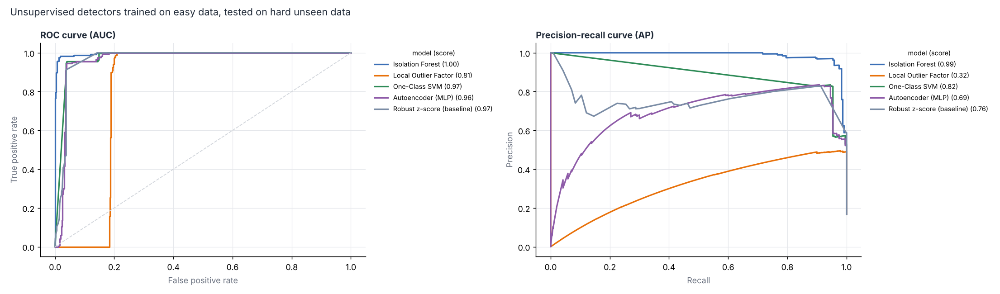
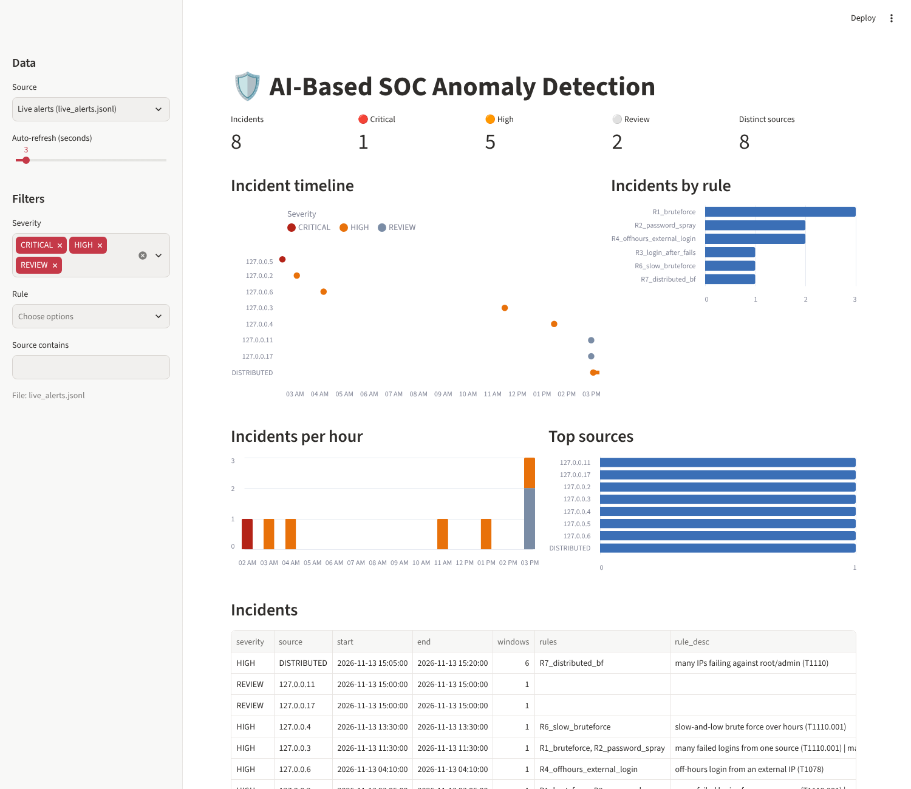

# 🔐 AI-Based SOC Anomaly Detection System

> **A Security Operations Center (SOC) pipeline that combines detection rules and machine learning to find attacks in Linux authentication logs.**

<p align="center">
  
  
  
  
  
</p>

<p align="center"></p>

---

## 📌 Overview

The system ingests SSH/sudo logs, turns them into per-source time-window features, and detects attacks with two complementary engines:

* 📏 **7 detection rules** mapped to MITRE ATT&CK (brute force, password spraying, compromise after failures, off-hours external login, privilege escalation, slow-and-low brute force, distributed brute force).
* 🌲 **Isolation Forest** (unsupervised) that scores every window, so unknown attacks surface as `REVIEW` alerts even when no rule matches.
* 🧯 **Incident grouping**: hundreds of window alerts become a handful of incidents with a severity (`CRITICAL` / `HIGH` / `REVIEW`).

Logs come from a built-in generator that injects realistic attacks and **benign look-alikes** (an admin working at 23:00, a user mistyping a password 12 times), so false positives are measured too. Wazuh integration with real logs is in progress.

## 📊 Results

Synthetic data. The hard dataset (stealth attacks + benign look-alikes) uses a seed that was never used while tuning the rules.

| Dataset | Detector | Window precision | Window recall |
|---|---|---|---|
| Easy | ML only | 0.42 | 1.00 |
| Easy | Rules + ML | 1.00 | 1.00 |
| Hard | ML only | 0.90 | 0.99 |
| Hard | Rules only | 1.00 | 0.78 |
| Hard | **Hybrid (rules + ML)** | **1.00** | 0.87 |

At the **incident** level (what an analyst actually sees): easy dataset 9 incidents, 9/9 attacks caught, 0 false; hard dataset 21 incidents, **17/17 attack episodes caught, 0 false incidents**. The window recall of the hybrid is lower because the long-window rules need a few windows to accumulate evidence on slow attacks.

### Real-attack lab (real sshd, exact ground truth)

`bash lab/run_lab.sh` starts a **real OpenSSH server** (loopback only, port 2222) with an accelerated clock (a virtual day in ~6 min) and attacks it for real from different `127.0.0.N` source addresses: brute force, password spray, slow-and-low, brute force then successful login, off-hours login with stolen credentials, and a 12-IP distributed attack, mixed with legitimate logins and typos from `127.0.0.1`. Ground truth is exact (source address), and the log lines are produced by sshd itself, not by a generator.

| Detector | Window precision | Window recall |
|---|---|---|
| ML only | 0.89 | 0.95 |
| Rules only | 1.00 | 0.61 |
| **Hybrid** | **1.00** | 0.71 |

8 incidents raised, all real; **6/6 attack episodes caught, 0 false incidents**. The ML model was trained on the synthetic data only, so these are unseen real sshd logs.

<p align="center"></p>

The lab creates three throw-away users (`lab_*`) and a loopback-only sshd; remove the users with `bash lab/lab_down.sh --clean`.

### Live mode, alerting and IP blocking

`src/live.py` follows a log file in real time (or replays one), scores it every 5 minutes of log time with the same rules and model, and raises each incident **once** (again only if its severity escalates):

```bash
python3 src/detect.py                                    # train the model once
python3 src/live.py --log /var/log/auth.log --follow     # real time (needs read access to the log)
python3 src/live.py --log data/hard/auth.log --replay --step-min 30   # replay an existing log
bash lab/run_live_demo.sh                                # real sshd + real attacks + live alerts together
```

* **Channels:** console and `reports/live_alerts.jsonl` always; **Telegram** (`TELEGRAM_BOT_TOKEN`, `TELEGRAM_CHAT_ID`) and **e-mail** (`SMTP_HOST`, `SMTP_USER`, `SMTP_PASSWORD`, `ALERT_TO`) when configured; only HIGH and above are pushed (`--min-notify`).
* **Automatic response:** CRITICAL incidents (a successful login after a brute force) trigger an `iptables` block of the source. It is a **dry run unless `--enforce`**, and the blocker never touches private, loopback or allow-listed addresses (`--allow IP ...`), so it cannot lock you out.
* Every alert lists the rules that fired with their MITRE ATT&CK technique.

### Model comparison

Five unsupervised detectors trained on the easy dataset and tested on the unseen hard dataset (`python3 src/compare_models.py`):

| Model | ROC-AUC | PR-AUC | Best F1 |
|---|---|---|---|
| **Isolation Forest** | **0.997** | **0.987** | **0.962** |
| One-Class SVM | 0.974 | 0.816 | 0.887 |
| Robust z-score (baseline) | 0.967 | 0.758 | 0.869 |
| Autoencoder (MLP) | 0.964 | 0.690 | 0.883 |
| Local Outlier Factor | 0.812 | 0.320 | 0.658 |

<p align="center"></p>

### Live dashboard (Streamlit)

Run the live detector in one terminal and the dashboard in another. The page refreshes itself and shows incidents as they are raised (severity KPIs, timeline per source, rules hit, incidents per hour, filterable table with MITRE descriptions). It can also open any batch result (`reports/*_incidents.csv`).

```bash
bash lab/run_live_demo.sh          # terminal 1: real sshd attacks + live detector
bash scripts/run_dashboard.sh      # terminal 2: dashboard on http://localhost:8501
```

<p align="center"></p>

### Sequence model: does temporal context help?

`python3 src/sequence_model.py` scores each window from the last 4 windows (20 min) of the same source with a neural autoencoder (scikit-learn MLP, no GPU needed). The history length was chosen on a separate validation set (seed 7), then evaluated once on the unseen hard set (seed 99). Same 8 raw features for both rows, so the only difference is temporal context:

| Model (8 raw features) | ROC-AUC | PR-AUC | Best F1 |
|---|---|---|---|
| Sequence autoencoder (4 x 5 min) | 0.990 | 0.951-0.963 | 0.918-0.928 |
| Isolation Forest, single window | 0.991 | 0.953 | 0.954 |
| *Isolation Forest, full 16 features (table above)* | *0.997* | *0.987* | *0.962* |

Result: raw history gives no clear gain over a single window (PR-AUC across 4 training seeds is a tie, best F1 is lower), and both stay below Isolation Forest on the engineered features, which already encode history (`fails_1h`, `fails_6h`, `active_win_1h`, `global_ips_30m`). On this dataset, hand-built temporal features beat learned temporal context; a real LSTM or transformer would need more and more varied data to pay off.

> ⚠️ The generator and the rules were written by the same author, so these numbers validate the *pipeline*, not real-world accuracy. Validation on real logs (Wazuh, public Loghub dataset) is on the roadmap.

## 🚀 Getting Started

```bash
git clone https://github.com/sarra1011/ai-soc-anomaly-detection.git
cd ai-soc-anomaly-detection

bash scripts/setup.sh              # virtualenv + dependencies
source .venv/bin/activate
python3 src/main.py                # full pipeline -> reports/soc_dashboard.png
pytest -q                          # unit tests
```

Run one stage at a time:

```bash
python3 src/gen_logs.py --days 7           # data/raw/auth.log + labels.csv
python3 src/parse_features.py              # data/processed/features.csv
python3 src/detect.py                      # trains the Isolation Forest
python3 src/hybrid.py                      # rules + ML -> incidents
```

Optional Wazuh stack (Docker, ~4 GB RAM): `bash scripts/setup_wazuh.sh`, then open https://localhost

## 📁 Project Structure

```text
├── src/
│   ├── gen_logs.py          # synthetic auth.log + labelled attacks
│   ├── gen_hard.py          # stealth attacks + benign look-alikes
│   ├── parse_features.py    # regex parser + window features
│   ├── detect.py            # Isolation Forest (unsupervised)
│   ├── hybrid.py            # rules R1-R7 + ML -> incidents
│   ├── live.py              # real-time follow / replay, incident dedupe
│   ├── alerting.py          # console, JSONL, Telegram, e-mail, safe IP blocker
│   ├── compare_models.py    # IF vs LOF vs OC-SVM vs autoencoder (ROC / PR)
│   ├── sequence_model.py    # temporal-context autoencoder vs single window
│   ├── dashboard.py         # live Streamlit dashboard (dashboard_data.py = data layer)
│   ├── report.py            # 4-panel dashboard
│   └── main.py              # runs everything end to end
├── lab/                     # real sshd + real attacks + exact ground truth
├── scripts/                 # setup.sh, run_real.sh, setup_wazuh.sh
├── tests/                   # pytest unit tests (parser + rules)
├── docs/                    # architecture, rules, MITRE mapping
├── notebooks/               # exploratory analysis
├── data/, logs/             # samples (generated data is git-ignored)
└── .github/workflows/ci.yml # tests + pipeline on every push
```

See [`docs/architecture.md`](docs/architecture.md) for the design decisions and the rule table.

## 🛠️ Technologies

| Category | Technology |
| :--- | :--- |
| Language | Python 3.10+ |
| Data / ML | pandas, NumPy, scikit-learn (Isolation Forest) |
| Visualization | Matplotlib |
| SIEM | Wazuh (Docker) |
| Quality | pytest, GitHub Actions |

## 🚧 Roadmap

- [x] Log generator with labelled attacks and benign look-alikes
- [x] Parser + feature engineering (5 min, 1 h, 6 h windows, global features)
- [x] Isolation Forest + 7 MITRE-mapped rules + incident grouping
- [x] Dashboard, unit tests, CI
- [ ] 🛡️ Wazuh integration with real logs (in progress)
- [x] ⚔️ Real attacks against a real sshd (`lab/`)
- [x] 📚 Validation on the public Loghub OpenSSH dataset
- [x] 🧠 Model comparison (Isolation Forest, LOF, One-Class SVM, autoencoder, z-score)
- [x] 🧬 Sequence model (windowed autoencoder; LSTM / transformer would need more data)
- [x] 🔔 Alerting (Telegram / email), live mode and automatic IP blocking (dry-run by default)
- [x] 📈 Live dashboard (Streamlit)

## 📝 License

Distributed under the project LICENSE. See [`LICENSE`](LICENSE).
