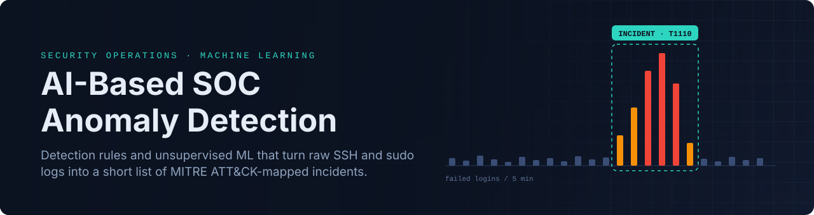
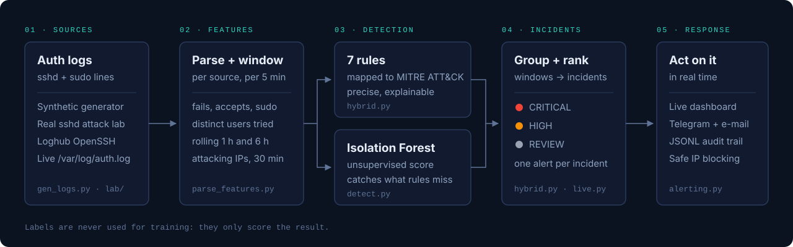
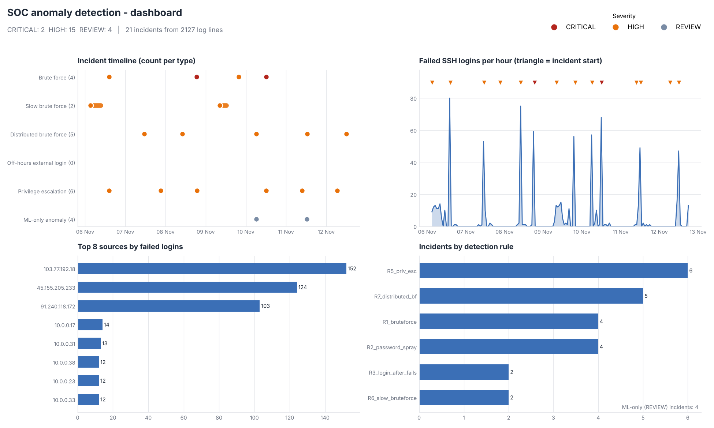
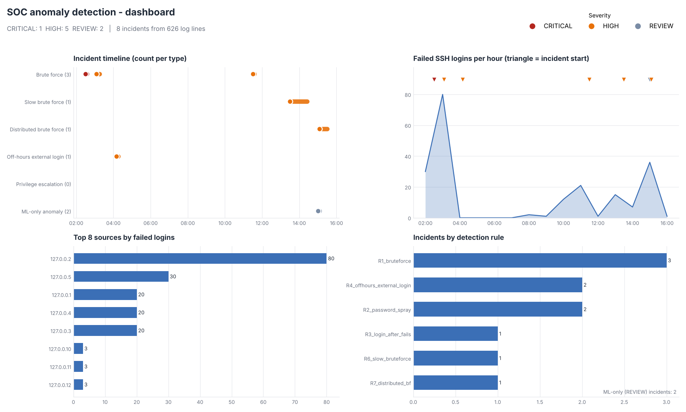

<p align="center">
  
</p>

<p align="center">
  <a href="https://github.com/sarra1011/ai-soc-anomaly-detection/actions/workflows/ci.yml"></a>
  
  
  
  
  <a href="LICENSE"></a>
</p>

<p align="center">
  <a href="#how-it-works">How it works</a> ·
  <a href="#results">Results</a> ·
  <a href="#live-mode">Live mode</a> ·
  <a href="#quick-start">Quick start</a> ·
  <a href="#limitations">Limitations</a> ·
  <a href="#references">References</a>
</p>

---

A SOC analyst drowns in alerts: thousands of failed logins a day, almost all of them noise. This project reads Linux authentication logs (`sshd`, `sudo`) and reduces them to **a handful of ranked incidents**, each one explained by the rule that fired and its MITRE ATT&CK technique.

It combines two engines that cover each other's blind spots. **Detection rules** are precise and explainable but only know the attacks they were written for. An **Isolation Forest** needs no labels and flags anything unusual, at the cost of more false alarms. Together they reach **zero false incidents** on every dataset tested, while still catching every attack episode.

## Highlights

| Result | Measured on |
|---|---|
| **17 / 17** attack episodes caught, **0** false incidents | Hard synthetic set: stealth attacks, benign look-alikes, unseen seed |
| **6 / 6** attack episodes caught, **0** false incidents | Real attacks against a real OpenSSH server, exact ground truth |
| **0.987** PR-AUC | Isolation Forest, best of 5 unsupervised models compared |
| **Real time** | Live detector, Telegram and e-mail alerts, auto-refreshing dashboard |
| **Safe response** | IP blocking is a dry run by default and never touches private or allow-listed addresses |
| **19 tests**, CI on every push | Parser, rules, live detector, blocker safety, dashboard data layer |

## How it works

<p align="center">
  
</p>

1. **Parse.** Regex parsing of syslog lines into events: failed and accepted logins, invalid users, sudo commands, sudo denials.
2. **Window.** One feature row per source per 5 minutes, where a source is an IP address or a local user. Short windows miss slow attacks, so each row also carries rolling 1 h and 6 h history and a global count of distinct attacking IPs over 30 minutes.
3. **Detect.** Seven rules and an Isolation Forest score every window independently.
4. **Group.** Alerting windows from the same source within 30 minutes merge into one incident. Distributed attacks merge into a single campaign across sources.
5. **Rank.** `CRITICAL` means a login succeeded after repeated failures. `HIGH` means a rule matched. `REVIEW` means only the model found it unusual.

### Detection rules

| Rule | Fires when | Severity | ATT&CK |
|---|---|---|---|
| R1 Brute force | 10+ failures in a window from a suspect source | HIGH | [T1110.001](https://attack.mitre.org/techniques/T1110/001/) |
| R2 Password spraying | 4+ distinct users tried with 5+ failures | HIGH | [T1110.003](https://attack.mitre.org/techniques/T1110/003/) |
| R3 Login after failures | 5+ failures then a successful login | CRITICAL | [T1110](https://attack.mitre.org/techniques/T1110/), [T1078](https://attack.mitre.org/techniques/T1078/) |
| R4 Off-hours external login | Successful login from an external IP outside working hours | HIGH | [T1078](https://attack.mitre.org/techniques/T1078/) |
| R5 Privilege escalation | Denied sudo, root shell or shadow file access | HIGH | [T1548.003](https://attack.mitre.org/techniques/T1548/003/), [T1003.008](https://attack.mitre.org/techniques/T1003/008/) |
| R6 Slow brute force | 8+ failures over 1 h spread across 5+ windows | HIGH | [T1110.001](https://attack.mitre.org/techniques/T1110/001/) |
| R7 Distributed brute force | 8+ distinct external IPs failing on root or admin in 30 min | HIGH | [T1110](https://attack.mitre.org/techniques/T1110/) |

Design decisions and trade-offs are documented in [`docs/architecture.md`](docs/architecture.md).

## Results

Labels are used only to score results, never to train. The model is fitted on the easy dataset and every other dataset is unseen.

### Synthetic logs

The generator injects attacks together with **benign look-alikes**: an admin working at 23:00, a user mistyping a password 12 times, a VPN login from abroad. The hard set adds slow and distributed attacks and uses a seed never seen while tuning.

| Dataset | Detector | Window precision | Window recall | Incidents |
|---|---|---|---|---|
| Easy | ML only | 0.42 | 1.00 | |
| Easy | **Rules + ML** | **1.00** | **1.00** | 9 raised, 9 / 9 attacks, 0 false |
| Hard | ML only | 0.90 | 0.99 | |
| Hard | Rules only | 1.00 | 0.78 | |
| Hard | **Rules + ML** | **1.00** | 0.87 | 21 raised, 17 / 17 attacks, 0 false |

Hybrid window recall is below 1.00 because slow attacks need a few windows of evidence before a rule fires. At incident level, which is what an analyst sees, no attack is missed.

<p align="center"></p>

### Real attacks on a real sshd

`bash lab/run_lab.sh` starts a real OpenSSH server on loopback and attacks it from separate `127.0.0.N` source addresses: brute force, password spraying, slow-and-low, brute force followed by a successful login, off-hours login with stolen credentials, and a 12-IP distributed attack, mixed with legitimate logins and typos. The log lines come from sshd itself and the source address gives exact ground truth.

| Detector | Window precision | Window recall |
|---|---|---|
| ML only | 0.89 | 0.95 |
| Rules only | 1.00 | 0.61 |
| **Rules + ML** | **1.00** | 0.71 |

8 incidents raised, all real, **6 / 6 attack episodes caught**. The model had only ever seen synthetic data.

<p align="center"></p>

### Public real-world logs

`bash scripts/run_real.sh` runs the same pipeline, unchanged, on the [Loghub](https://github.com/logpai/loghub) OpenSSH logs collected from an internet-facing server. On the 2,000-line sample it raises 12 incidents: 8 `HIGH` (brute force and password spraying, the expected background noise of the internet) and 4 `REVIEW`. The dataset has no labels, so this checks that the parser and rules hold on logs the project did not generate. It is not an accuracy measurement.

### Model comparison

Five unsupervised detectors, trained on the easy set and tested on the hard set (`python3 src/compare_models.py`). PR-AUC is the headline metric because attacks are the minority class.

| Model | ROC-AUC | PR-AUC | Best F1 |
|---|---|---|---|
| **Isolation Forest** | **0.997** | **0.987** | **0.962** |
| One-Class SVM | 0.974 | 0.816 | 0.887 |
| Robust z-score (baseline) | 0.967 | 0.758 | 0.869 |
| Autoencoder (MLP) | 0.964 | 0.690 | 0.883 |
| Local Outlier Factor | 0.812 | 0.320 | 0.658 |

<p align="center"></p>

### Does learned temporal context help?

A sequence autoencoder scores each window from the last 20 minutes of the same source (`python3 src/sequence_model.py`). The history length was chosen on a separate validation set, then evaluated once on the hard set. Both rows use the same 8 raw features, so the only difference is temporal context.

| Model | ROC-AUC | PR-AUC | Best F1 |
|---|---|---|---|
| Sequence autoencoder, 4 × 5 min | 0.990 | 0.951 to 0.963 | 0.918 to 0.928 |
| Isolation Forest, single window | 0.991 | 0.953 | 0.954 |
| *Isolation Forest, 16 engineered features* | *0.997* | *0.987* | *0.962* |

**A negative result, reported as such.** Learned history ties with single-window detection across four training seeds, and both lose to hand-built temporal features (`fails_1h`, `fails_6h`, `global_ips_30m`). On this amount of data, feature engineering beats sequence learning, which matches what the log-analysis literature reports for simple baselines [[7]](#references).

## Live mode

`src/live.py` follows a log file as it grows, scores it with the same rules and model, and raises each incident **once**. It alerts again only if the severity escalates.

```bash
python3 src/live.py --log /var/log/auth.log --follow                  # real time
python3 src/live.py --log data/hard/auth.log --replay --step-min 30   # replay a file
bash lab/run_live_demo.sh                                             # real sshd + attacks + live alerts
```

**Alerting.** Console and `reports/live_alerts.jsonl` always. Telegram when `TELEGRAM_BOT_TOKEN` and `TELEGRAM_CHAT_ID` are set, e-mail when `SMTP_HOST` and `ALERT_TO` are set. Every alert lists the rules that fired and their ATT&CK technique.

**Automatic response.** A `CRITICAL` incident triggers an `iptables` block of the source. It is a dry run unless `--enforce` is passed, and the blocker refuses private, loopback, reserved and allow-listed addresses, so it cannot lock out its own operator.

**Dashboard.** A Streamlit page that refreshes itself while the detector runs: severity counters, timeline per source, rules hit, incidents per hour and a filterable incident table.

```bash
bash lab/run_live_demo.sh       # terminal 1
bash scripts/run_dashboard.sh   # terminal 2, then open http://localhost:8501
```

<p align="center"></p>

## Quick start

```bash
git clone https://github.com/sarra1011/ai-soc-anomaly-detection.git
cd ai-soc-anomaly-detection

bash scripts/setup.sh       # virtualenv + dependencies
source .venv/bin/activate
python3 src/main.py         # full pipeline, writes reports/soc_dashboard.png
pytest -q                   # 19 tests
```

Run one stage at a time:

```bash
python3 src/gen_logs.py --days 7     # data/raw/auth.log + labels.csv
python3 src/parse_features.py        # data/processed/features.csv
python3 src/detect.py                # train the Isolation Forest
python3 src/hybrid.py                # rules + ML -> incidents
```

The real-sshd lab needs `sudo` and creates three throw-away `lab_*` users. Remove them with `bash lab/lab_down.sh --clean`.

## Project structure

```text
├── src/
│   ├── gen_logs.py          synthetic auth.log with labelled attacks
│   ├── gen_hard.py          stealth attacks + benign look-alikes
│   ├── parse_features.py    regex parser + window features
│   ├── detect.py            Isolation Forest
│   ├── hybrid.py            rules R1-R7 + ML -> incidents
│   ├── live.py              real-time follow / replay, incident dedupe
│   ├── alerting.py          console, JSONL, Telegram, e-mail, safe IP blocker
│   ├── compare_models.py    five unsupervised models, ROC / PR
│   ├── sequence_model.py    temporal-context autoencoder
│   ├── dashboard.py         live Streamlit dashboard
│   ├── report.py            static 4-panel dashboard
│   └── main.py              runs everything end to end
├── lab/                     real sshd + real attacks + exact ground truth
├── scripts/                 setup, Loghub run, dashboard launcher
├── tests/                   pytest suite
├── docs/                    architecture and design decisions
└── .github/workflows/       CI
```

## Limitations

Stated plainly, because security ML results are easy to oversell [[5]](#references)[[6]](#references):

- **Synthetic data and rules share an author.** The synthetic scores validate the pipeline, not real-world accuracy. The real-sshd lab and Loghub run reduce this bias but do not remove it.
- **The lab attacks come from loopback.** They are real sshd log lines, but from scripted attackers on one machine, not from a production network.
- **Small scale.** A few thousand windows. Base rates in production are far lower, so false positives would matter more than these numbers suggest [[6]](#references).
- **One log source.** Authentication logs only. No network, process or file telemetry.
- **Static thresholds.** Rule thresholds were set by hand and would need tuning per environment.

## Roadmap

- [x] Log generator with labelled attacks and benign look-alikes
- [x] Parser and feature engineering (5 min, 1 h, 6 h, global)
- [x] Isolation Forest, 7 ATT&CK-mapped rules, incident grouping
- [x] Real attacks against a real sshd
- [x] Validation on public Loghub OpenSSH logs
- [x] Model comparison and sequence model
- [x] Live mode, Telegram and e-mail alerts, safe IP blocking
- [x] Live dashboard
- [ ] Wazuh SIEM integration
- [ ] Full 655k-line Loghub run with manual review of incidents
- [ ] More log sources (auditd, web server)

## References

The papers and resources this project builds on, and what each one contributed.

**Methods**

1. F. T. Liu, K. M. Ting, Z.-H. Zhou. [Isolation Forest](https://doi.org/10.1109/ICDM.2008.17). *IEEE ICDM*, 2008. The core model: anomalies are isolated in fewer random splits than normal points.
2. M. M. Breunig, H.-P. Kriegel, R. T. Ng, J. Sander. [LOF: Identifying Density-Based Local Outliers](https://doi.org/10.1145/342009.335388). *ACM SIGMOD*, 2000. Baseline in the model comparison.
3. B. Schölkopf, J. C. Platt, J. Shawe-Taylor, A. J. Smola, R. C. Williamson. [Estimating the Support of a High-Dimensional Distribution](https://doi.org/10.1162/089976601750264965). *Neural Computation*, 2001. The One-Class SVM baseline.
4. V. Chandola, A. Banerjee, V. Kumar. [Anomaly Detection: A Survey](https://doi.org/10.1145/1541880.1541882). *ACM Computing Surveys*, 2009. The vocabulary used here: point, contextual and collective anomalies.

**Machine learning in security, and why to be careful**

5. D. Arp et al. [Dos and Don'ts of Machine Learning in Computer Security](https://www.usenix.org/conference/usenixsecurity22/presentation/arp). *USENIX Security*, 2022. Ten common pitfalls. Motivated the unseen-seed test set, the separate validation set and the Limitations section.
6. R. Sommer, V. Paxson. [Outside the Closed World: On Using Machine Learning for Network Intrusion Detection](https://doi.org/10.1109/SP.2010.25). *IEEE S&P*, 2010. Why anomaly detection is harder in security than elsewhere, and why explainable alerts matter.
7. V.-H. Le, H. Zhang. [Log-based Anomaly Detection with Deep Learning: How Far Are We?](https://doi.org/10.1145/3510003.3510155) *ICSE*, 2022. Deep models do not always hold up under realistic evaluation, consistent with the sequence-model result above.
8. B. A. Alahmadi, L. Axon, I. Martinovic. [99% False Positives: A Qualitative Study of SOC Analysts' Perspectives on Security Alarms](https://www.usenix.org/conference/usenixsecurity22/presentation/alahmadi). *USENIX Security*, 2022. Why this project optimises for few, explained incidents instead of raw recall.
9. J. Davis, M. Goadrich. [The Relationship Between Precision-Recall and ROC Curves](https://doi.org/10.1145/1143844.1143874). *ICML*, 2006. Why PR-AUC is reported next to ROC-AUC on imbalanced data.

**Log analysis**

10. M. Du, F. Li, G. Zheng, V. Srikumar. [DeepLog: Anomaly Detection and Diagnosis from System Logs through Deep Learning](https://doi.org/10.1145/3133956.3134015). *ACM CCS*, 2017. The reference sequence model for logs and the natural next step with more data.
11. S. He, J. Zhu, P. He, M. R. Lyu. [Experience Report: System Log Analysis for Anomaly Detection](https://doi.org/10.1109/ISSRE.2016.21). *IEEE ISSRE*, 2016. The parse, window, featurise, detect structure followed here.

**Data and frameworks**

12. J. Zhu, S. He, P. He, J. Liu, M. R. Lyu. [Loghub: A Large Collection of System Log Datasets for AI-driven Log Analytics](https://arxiv.org/abs/2008.06448). *IEEE ISSRE*, 2023. Source of the public OpenSSH logs.
13. [MITRE ATT&CK](https://attack.mitre.org/): [T1110 Brute Force](https://attack.mitre.org/techniques/T1110/), [T1078 Valid Accounts](https://attack.mitre.org/techniques/T1078/), [T1548 Abuse Elevation Control Mechanism](https://attack.mitre.org/techniques/T1548/).
14. [scikit-learn](https://scikit-learn.org/stable/modules/outlier_detection.html) outlier detection guide, [Streamlit](https://docs.streamlit.io/), [OpenSSH](https://www.openssh.com/manual.html).

## License

MIT. See [`LICENSE`](LICENSE).

<p align="center"><sub>Built by <a href="https://github.com/sarra1011">Sarra Bahlous</a> · ENSI, University of Manouba</sub></p>
